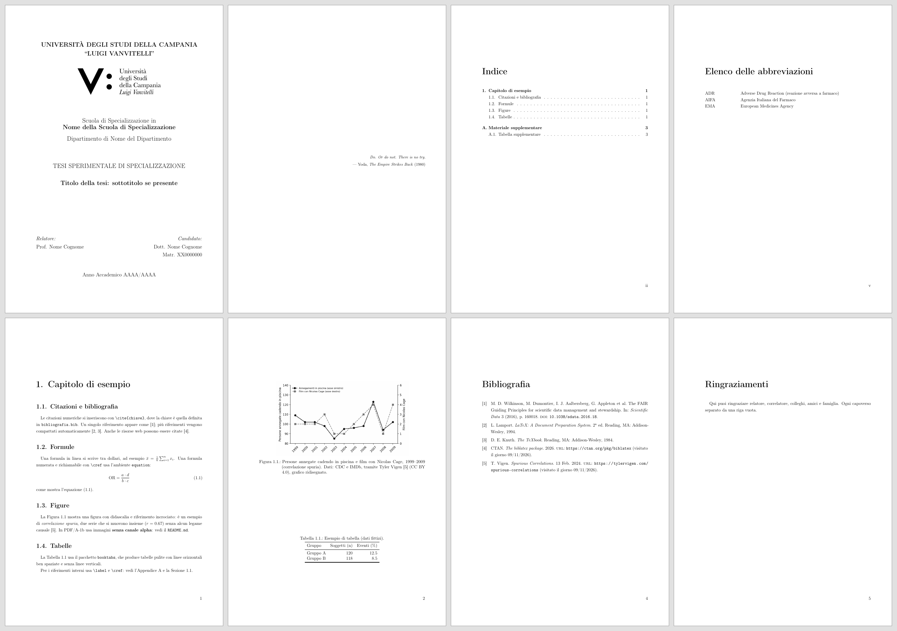

# Template LaTeX per tesi — Università della Campania "Luigi Vanvitelli"

Questo template è un punto di partenza per scrivere la tesi in LaTeX. Produce un PDF con frontespizio, riassunto, indice, elenco di figure e tabelle, capitoli, appendici e bibliografia. Può anche produrre un file **PDF/A-1b**, il formato per l'archiviazione.

Ho progettato questo template parallelamente alla stesura della mia tesi di specializzazione ma si adatta anche ad altri corsi (laurea triennale, magistrale, dottorato).

Usare LaTeX per scrivere la tesi ha dei pro (tanti) e dei contro (pochi e superabili, secondo me). Se vuoi decidere consapevolmente se LaTeX fa al caso tuo, ti invito a leggere una [lista esaustiva di pro e contro](https://www.scijournal.org/articles/pros-and-cons-of-using-latex).

Se vuoi vedere il risultato completo del PDF compilato con tutte le pagine facoltative, apri il [PDF d'esempio](docs/esempio.pdf).

> Questo è un **progetto non ufficiale**. Non è un modello approvato dall'Ateneo o da un Dipartimento o da una Scuola di Specializzazione/Dottorato. Prima di consegnare, controlla frontespizio, margini e formato con la Segreteria.

## Cosa serve

1. **Una distribuzione LaTeX**: [TeX Live](https://tug.org/texlive/) (2023 o successiva) oppure MiKTeX. Deve includere `pdflatex`, `biber` e `latexmk`.
2. **Un editor di testo: consiglio [Visual Studio Code](https://code.visualstudio.com/)** con l'estensione gratuita **LaTeX Workshop**. È gratuito, funziona su Windows, macOS e Linux, compila con un clic e mostra il PDF accanto al testo. Io ho lavorato così.

Non vuoi installare nulla? Puoi usare [Overleaf](https://www.overleaf.com/): carica lo ZIP, scegli *pdfLaTeX* come compilatore (TeX Live 2023 o successivo) e `main.tex` come file principale. Sembra la strada più semplice, ma negli ultimi tempi Overleaf sta limitando l'utilizzo nella sua versione gratuita.

## Come iniziare

1. Su GitHub clicca **Use this template** (oppure scarica lo ZIP).
2. Metti la cartella in un **percorso corto, senza spazi e senza accenti** del tuo PC, ad esempio `C:\tesi\`.
3. Apri la cartella con VS Code (*File → Apri cartella*).
4. Apri `config.tex` e sostituisci i segnaposto con i tuoi dati.
5. Apri `main.tex` e compila: clic sul pulsante verde **Build LaTeX project** in alto a destra (scegli la ricetta `latexmk`), oppure `Ctrl+Alt+B`.
6. Sostituisci `BODY/1_esempio.tex` con il tuo primo capitolo. Per ogni nuovo capitolo crea un file in `BODY/` e aggiungi in `main.tex` una riga `\include{BODY/2_nome}` (senza `.tex`).

## Cosa c'è nella cartella

| File / cartella | A cosa serve |
|---|---|
| `config.tex` | **Qui si inseriscono i dati**: titolo, relatore, candidato, matricola, anno accademico. Qui si trovano anche gli interruttori |
| `main.tex` | Struttura del documento. Di solito non serve toccarlo |
| `frontespizio.tex`, `main.xmpdata` | Frontespizio e metadati del PDF. Leggono i dati da `config.tex`: **non vanno modificati** |
| `abstract.tex` | Riassunto della tesi |
| `epigrafe.tex` | Pagina di citazioni dopo il frontespizio (facoltativa) |
| `dedica.tex` | Pagina di dedica (facoltativa) |
| `ringraziamenti.tex` | Pagina dei ringraziamenti, in fondo alla tesi dopo la bibliografia (facoltativa) |
| `abbreviazioni.tex` | Elenco delle abbreviazioni, dopo l'indice (facoltativo) |
| `BODY/` | Un file per capitolo, più l'appendice. Sono esempi da sostituire |
| `bibliografia.bib` | Bibliografia (4 voci di esempio) |
| `FIGURE/` | Le immagini (vedi `FIGURE/README.md`) |
| `latexmkrc` | Impostazioni di `latexmk` |
| `.github/workflows/build.yml` | Compilazione e controllo PDF/A automatici su GitHub |
| `docs/` | Anteprima e PDF d'esempio mostrati in questo README (si possono cancellare) |

## Impostare i dati: `config.tex`

Tutti i dati della tesi stanno in `config.tex`.

- Nei valori scrivi testo semplice: niente comandi LaTeX complessi, soprattutto in `\TitoloTesi` e `\Candidato` (finiscono anche nelle proprietà del PDF).
- `\Correlatore` si lascia vuoto se non c'è.
- `\FileLogo` vuoto = frontespizio senza logo.
- Gli interruttori accendono o spengono una funzione: `\...true` la attiva, `\...false` la toglie.
  - `\pdfatrue` / `\pdfafalse`: PDF/A-1b (vedi sotto).
  - `\epigrafetrue` / `\epigrafefalse`: epigrafe.
  - `\dedicatrue` / `\dedicafalse`: dedica.
  - `\ringraziamentitrue` / `\ringraziamentifalse`: ringraziamenti.
  - `\abbreviazionitrue` / `\abbreviazionifalse`: elenco delle abbreviazioni.
- Le pagine facoltative sono tutte attive nel template, con testo di esempio. **Riscrivi il testo oppure spegni l'interruttore**, altrimenti nel PDF finale restano i segnaposto.
- Nell'elenco delle abbreviazioni scrivi una riga per sigla, in ordine alfabetico, nel formato `SIGLA & Significato \\`.

## Perché PDF/A-1b

PDF/A è lo standard ISO per **conservare i documenti a lungo termine**. Il file contiene tutto ciò che serve per aprirsi sempre allo stesso modo, anche tra decenni: font incorporati, nessuna password, nessun contenuto esterno. La versione **1b** è la più semplice e la più compatibile. Le Segreterie e la Biblioteca di Ateneo non richiedono questo standard, ma ritengo che sia comunque una scelta opportuna per garantire la conservazione, la leggibilità e la riproducibilità del documento nel lungo periodo.

Regole da ricordare quando il PDF/A è attivo:

- **Niente immagini PNG con trasparenza** (canale alpha): non sono ammesse. Appiattiscile su sfondo bianco (vedi `FIGURE/README.md`).
- Non togliere `\pdfminorversion=4` da `main.tex`. Senza, il PDF esce in versione 1.7 e non è più PDF/A-1b.
- `main.xmpdata` deve avere lo stesso nome di `main.tex`. Se rinomini uno, rinomina anche l'altro.
- Per l'euro scrivi `\texteuro{}`, non il carattere `€`.
- **Non aggiungere `\Keywords` a `main.xmpdata`.** `pdfx` scrive le parole chiave solo in una parte dei metadati, e veraPDF segnala il PDF come non conforme (regola 6.7.3-5, verificato). Titolo, autore, lingua, editore e oggetto sono invece inclusi.
- Due avvisi in compilazione sono normali e si possono ignorare: `xcolor: option hyperref obsolete` e `pdfx: Setting all color commands to rgb`.

## Citazioni e riferimenti

`BODY/1_esempio.tex` mostra come usare sezioni, citazioni (`\cite{chiave}`), formule, figure, tabelle e riferimenti con `\cref`.

- La bibliografia sta in `bibliografia.bib`. Puoi esportarla da Zotero, Mendeley o JabRef.
- Lo stile è numerico, nell'ordine di prima citazione. Per autore-anno, in `main.tex` cambia `style=numeric-comp` in `style=authoryear`.

## Compilare solo alcuni capitoli

Per risparmiare tempo mentre scrivi, in `main.tex` c'è il blocco `\includeonly`, già spiegato passo per passo. Ricordati di rimettere il `%` prima della versione finale.

## Licenza

Codice e testi del template: licenza [MIT](LICENSE).

**Eccezione:** il logo dell'Università (`FIGURE/logo_unicampania.png`) è un marchio dell'Ateneo. Non è coperto dalla licenza MIT e resta soggetto alle regole d'uso dell'Università.

## Contribuire

Segnalazioni e miglioramenti sono benvenuti, con *issue* e *pull request*. **Non inserire mai nel repository dati personali o parti di una tesi reale** (nomi, matricole, capitoli, figure, bibliografie).
